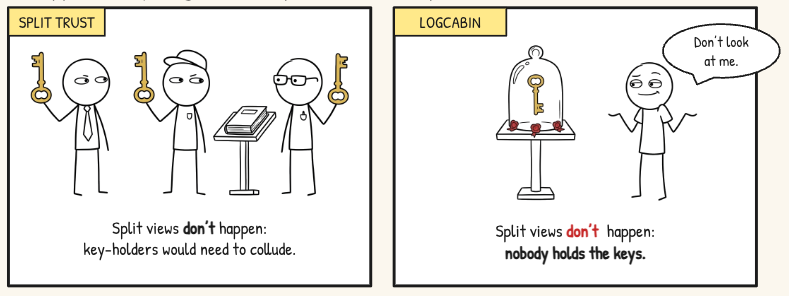
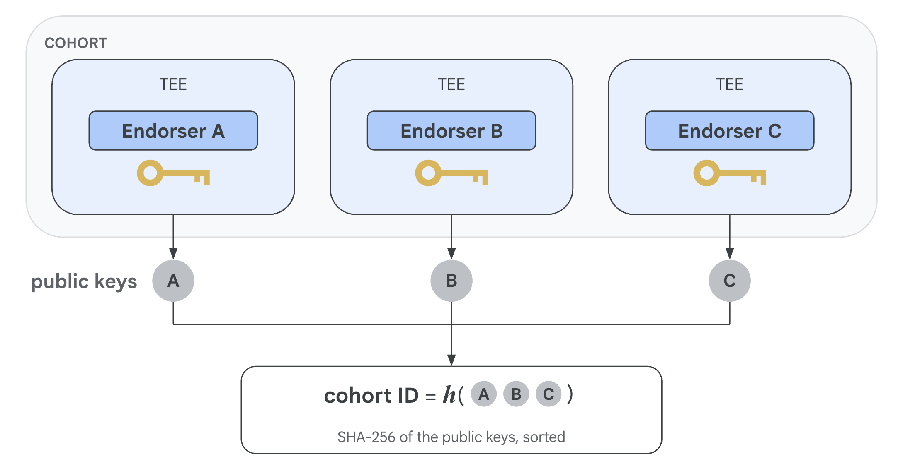
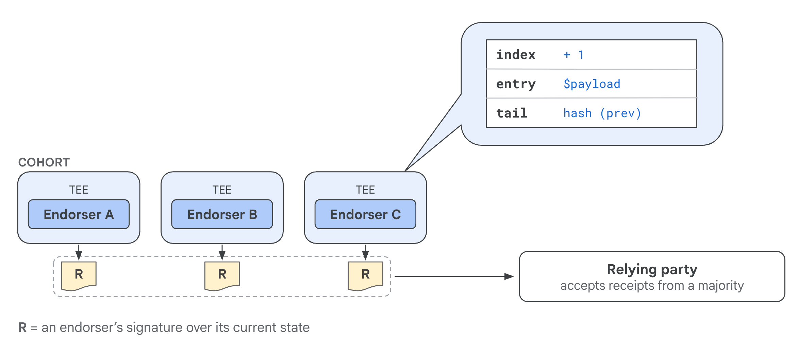
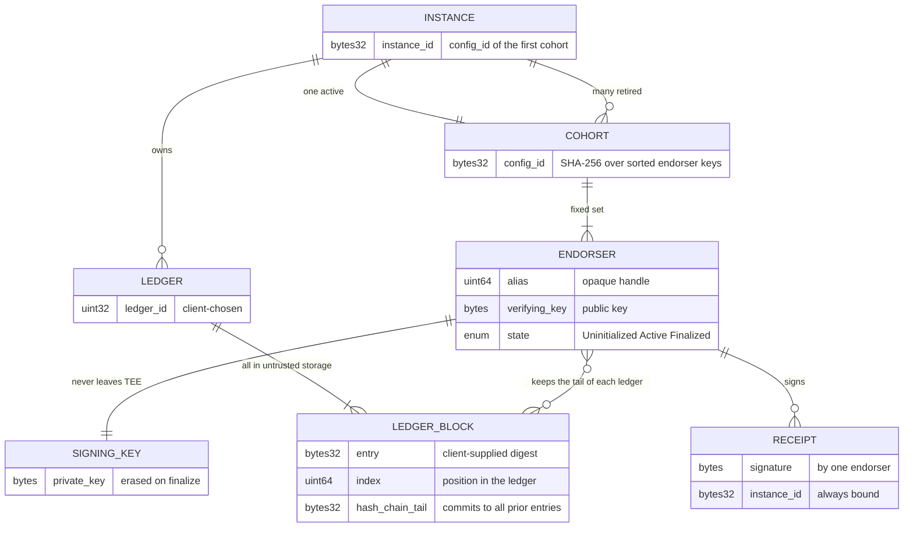

# Oak Log Cabin

A split-view resistant, tamper-evident ledger system.

By [Ernesto Ocampo](https://github.com/ernoc) · Licensed under the
[Apache License 2.0](LICENSE).

Traditional split view protection relies on several independent parties holding
the keys; a split view requires them to collude which makes it difficult and
unlikely. In LogCabin, noone ever has access to the signing keys.

LogCabin provides append-only ledgers whose integrity is endorsed by a quorum of
endorsers running in Trusted Execution Environments (TEE). The protocol is
inspired by [Nimble](https://github.com/microsoft/Nimble) Traditional split-view
protection relies on several independent parties holding the keys; a split view
requires them to collude, which makes it difficult and unlikely. In LogCabin, no
one ever has access to the signing keys.

LogCabin provides append-only ledgers whose integrity is endorsed by a quorum of
endorsers running in Trusted Execution Environments (TEEs). The protocol is
inspired by [Nimble](https://github.com/microsoft/Nimble)
([paper](https://www.usenix.org/system/files/osdi23-angel.pdf)), with some
[key differences](docs/protocol.md#13-differences-from-nimble).



## Security Claims

It is impossible for anyone — service administrators, infrastructure operators,
or external attackers — to create two different views of a ledger that would
both be accepted as valid by relying parties. The only exceptions are
physical-access attacks capable of extracting secrets directly from TEE memory —
where TEE guarantees themselves are broken.

### The Challenge

Don't take that claim on trust — try to break it!

[**The Split-View Challenge**](challenge/README.md) gives you direct control
over a cohort of endorsers and a mechanical harness that checks whether you
managed to produce two conflicting, verifiable views of the same ledger. Whether
you find a genuine fork or a clever near-miss that becomes a new regression
test, we'd love your contribution. Run `just challenge` to jump right in.

If you find a genuine break, please report it via [`SECURITY.md`](SECURITY.md)
rather than opening a public issue. For everything else,
[`CONTRIBUTING.md`](CONTRIBUTING.md) covers the CLA and pull request process.

## Protocol and Data Model

A LogCabin **instance** is a long-lived identity that provides a set of
append-only **ledgers**. An instance is served by a **cohort** of **endorsers**,
each running in a TEE. The cohort ID is made from the public keys of all its
endorsers, and the instance ID is the ID of its first cohort.



Each endorser keeps only the _tail_ block of each ledger: the latest entry, its
index, and a `hash_chain_tail` that folds in everything before it. The rest of
the log blocks live only in untrusted storage.

Endorsers produce signatures, called **receipts**, over their current state
(`read_latest`) and over append operations (`append_entry`). Their signing
(private) keys never leave the enclave. When an endorser finalizes, it deletes
its signing key.



A client only accepts a ledger state if a **quorum** — a strict majority of the
cohort — has signed the same block and operation. Split views are impossible:
any two majorities share at least one endorser, which never signs two
conflicting blocks. Furthermore, each receipt signs over the latest block,
including the `hash_chain_tail`, which means a majority must agree not only on
the latest entry and its index, but also on the same history of entries.

Cohorts are replaceable, but individual endorsers are not. A failed endorser
can't be replaced in the same cohort, and a live endorser can't be moved to
another cohort or hand over to another endorser, but a cohort can hand over to
another cohort.

Replacing failed endorsers or resizing a cohort requires a **handover** to an
entirely new cohort. In this process, outgoing endorsers sign a finalization
receipt that names the final ledger state and the **successor cohort**, then
erase their keys; incoming endorsers only activate if a majority of the outgoing
cohort signed for _exactly_ that state and _exactly_ their configuration. This
is key to split-view protection: a cohort can hand over to one and only one
successor cohort; a new cohort signs activation receipts naming its predecessor.
The chain of custody is strictly unsplit and auditable starting from either end.
The instance ID is propagated unchanged.

A client is configured to trust a given cohort, e.g. the instance's first one.
It will transfer its trust to the successor cohort if it verifies quorums of
finalization and activation receipts.

Finally, endorser public keys are bound to their hardware attestation reports,
which also bind their binary measurements. Therefore, the chain of finalization
and activation receipts makes the code stack run by every cohort auditable.



See **[docs/protocol.md](docs/protocol.md)** for the full specification: receipt
formats, identifier derivation, the endorser lifecycle, and sequence diagrams
for each protocol flow.

## Architecture

```
                        untrusted
 ┌──────────┐       ┌─────────────┐       ┌──────────────────────────────────┐
 │          │       │             │       │    Endorser (host - untrusted)   │
 │ Verifier │◄─────►│ Coordinator │◄─────►│                                  │
 │          │       │             │       │   ┌──────────────────────────┐   │
 └──────────┘       └──────┬──────┘       │   │          TEE VM          │   │
                           │              │   │                          │   │
                    ┌──────┴──────┐       │   │   ┌──────────────────┐   │   │
                    │    Store    │       │   │   │ Endorser Enclave │   │   │
                    └─────────────┘       │   │   │  App - trusted   │   │   │
                                          │   │   └──────────────────┘   │   │
                                          │   └──────────────────────────┘   │
                                          └──────────────────────────────────┘
```

- **Verifier** — a client-side library that validates endorser receipts against
  a trusted cohort configuration. It verifies quorum, signature validity, and
  ledger state consistency.
- **Coordinator** — an untrusted orchestration layer that routes requests
  between verifiers and endorsers, manages cohort lifecycles (activation,
  finalization, handover), and stores ledger data. _Not yet part of this
  repository._
- **Endorser** — a TEE-hosted enclave application that maintains ledger state
  and produces signed receipts. Each endorser's signing key is bound to the
  TEE's DICE attestation chain, so relying parties can verify that signatures
  were produced by a measured enclave binary.

## Endorser

Each endorser follows a strict lifecycle driven by the coordinator:

1. **Create** — the endorser is instantiated with a fresh signing key.
2. **Activate** — the endorser joins a cohort by verifying finalization receipts
   from the previous cohort (quorum check) and adopting handed-over state.
3. **Append / Read** — entries are appended to ledgers and clients can read the
   latest state, each operation producing a signed receipt.
4. **Finalize** — the endorser deletes its signing key, and its finalization
   receipt is used to activate the next cohort.

```
┌──────────────────────────────────┐
│              TEE VM              │
│                                  │
│   ┌──────────────────────────┐   │
│   │   LogCabin Enclave App   │   │
│   │        on Oak RK         │   │
│   │                          │   │
│   │   ┌──────────────────┐   │   │
│   │   │   LogCabin Svc   │   │   │
│   │   │   (micro RPC)    │   │   │
│   │   └──────────────────┘   │   │
│   └──────────────────────────┘   │
└──────────────────────────────────┘
```

## Verifier (Rust)

The verifier is a client-side library that checks endorser receipts against a
trusted cohort configuration. It is a critical part of the protocol's
correctness. If the verifier accepts a receipt, the client can be confident that
a quorum of endorsers agreed on the ledger state.

The verifier also processes cohort handovers to transfer its own trust from one
cohort to the next. It verifies that both the outgoing and incoming cohorts
reached quorum for the transition.

## Crate Structure

```
base/             Shared protocol primitives (CohortConfig, LedgerBlock, receipts)
verifier/rust/    Client-side receipt verification library
endorser/
├── core/         Protocol state machine (no_std, no I/O, pure logic)
├── service/      micro RPC service layer (attestation, endorser multiplexing, RPC handlers)
└── enclave_app/  TEE binary entry point
testing/
├── protocol/     Integration tests exercising endorser and verifier together
└── host_server/  gRPC testing server for local QEMU-based development
challenge/
└── in_process/   Public falsification challenge against the split-view claim
```

- `base` contains shared types and receipt message builders used by both the
  endorser and verifier.
- `verifier/rust` verifies endorser receipts against a trusted cohort
  configuration.
- `endorser/core` contains the endorser protocol with no I/O or platform
  dependencies.
- `endorser/service` wraps it as a micro RPC service and binds it to TEE
  attestation.
- `endorser/enclave_app` wires everything together and runs on
  [Oak Restricted Kernel](https://github.com/project-oak/oak).
- `challenge` invites anyone to falsify the security claim above.

See each crate's README for details.

## Developing LogCabin

### Prerequisites

- **Nix** — the development environment is fully managed via a Nix flake.
- **Bazel** — the primary build system (provided by the Nix dev shell).
- **Oak Repository** — LogCabin depends on
  [Project Oak](https://github.com/project-oak/oak) for shared toolchains,
  schemas, and runtime binaries.

### Oak Dependency Setup

By default, Bazel expects Oak to be checked out at `../oak` relative to the
LogCabin repository root. If your Oak checkout is in a different location,
create a local `.local.bazelrc` file (ignored by git) in the repository root:

```ini
# .local.bazelrc
common --override_module=oak=/path/to/your/oak/checkout
```

### Quick Start

To verify that everything is working, build and launch the testing gRPC server
on a local QEMU VM:

```
just run-testing-host-server
```

See [testing/host_server/](testing/host_server/README.md) for details.

### Suggested Tools

If using VS Code or Antigravity, install the **direnv** and **Rust Analyzer**
extensions, then run:

```
just regen-rust-project
```

## Disclaimer

This is not an officially supported Google product. This project is not eligible
for the
[Google Open Source Software Vulnerability Rewards Program](https://bughunters.google.com/open-source-security).
