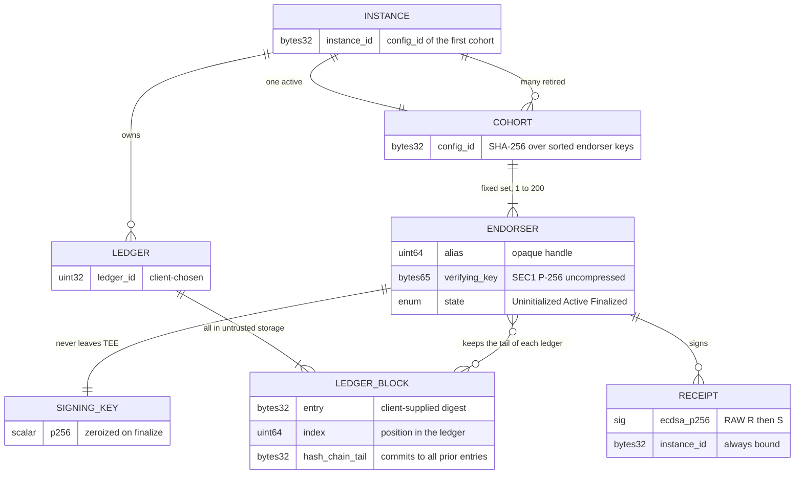
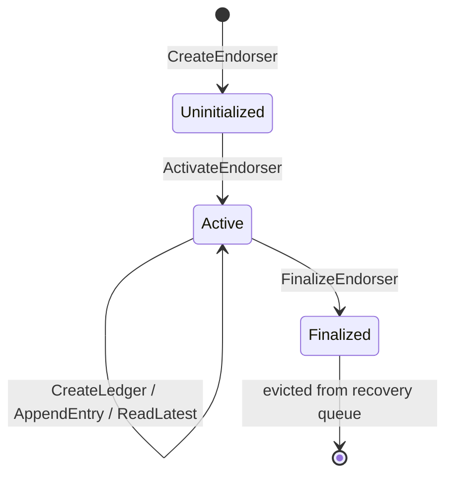
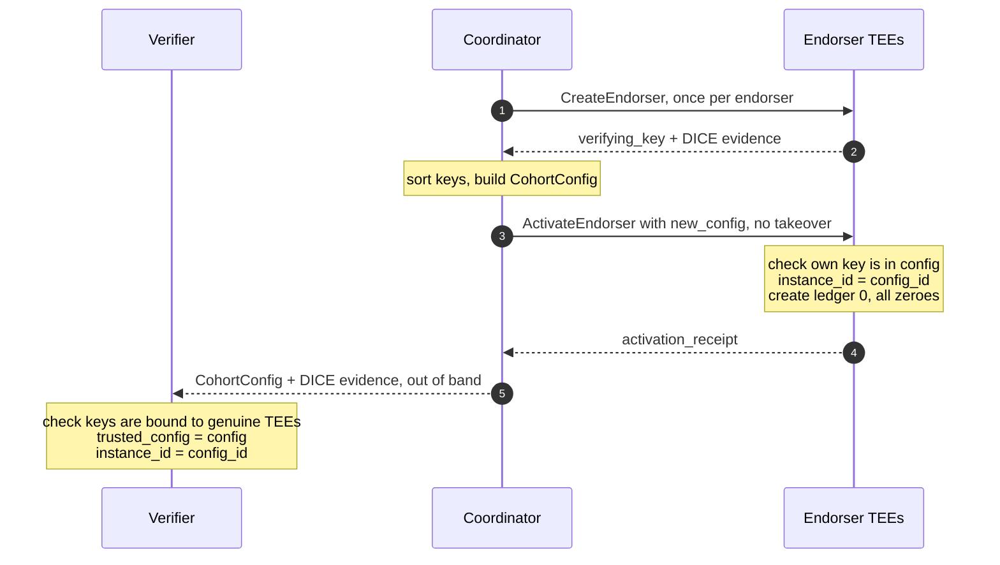
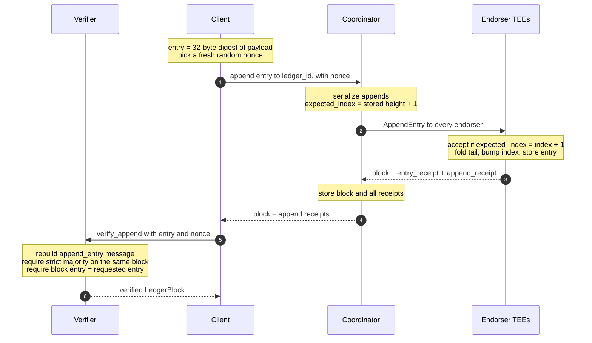
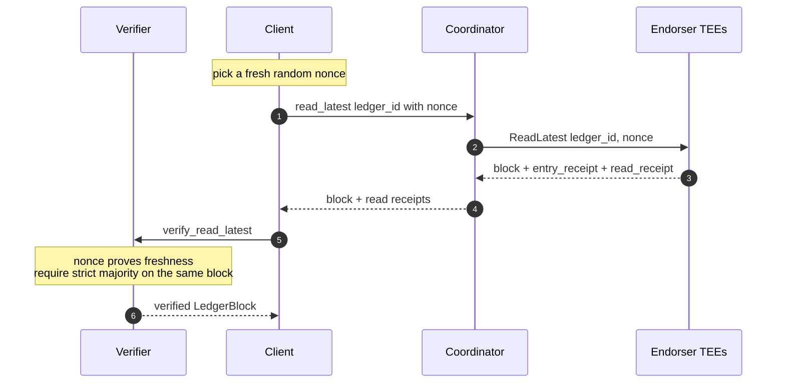
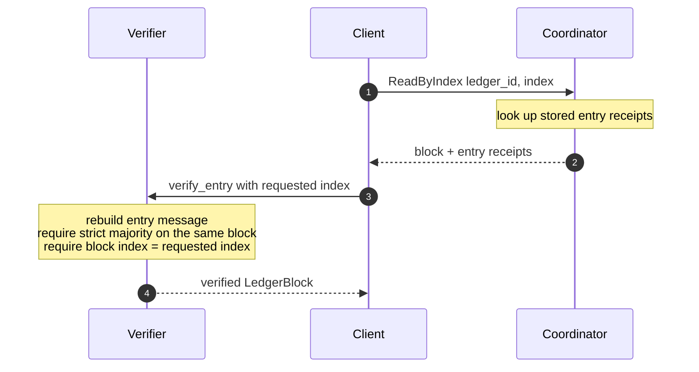
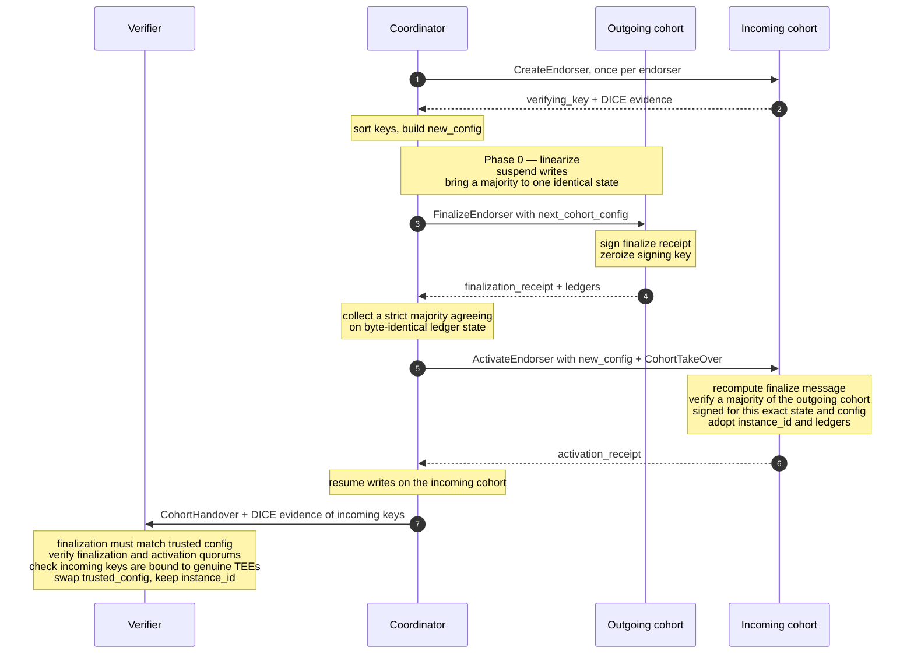

<!--
  Copyright 2026 The LogCabin Authors

  Licensed under the Apache License, Version 2.0 (the "License");
  you may not use this file except in compliance with the License.
  You may obtain a copy of the License at

      https://www.apache.org/licenses/LICENSE-2.0

  Unless required by applicable law or agreed to in writing, software
  distributed under the License is distributed on an "AS IS" BASIS,
  WITHOUT WARRANTIES OR CONDITIONS OF ANY KIND, either express or implied.
  See the License for the specific language governing permissions and
  limitations under the License.
-->

# The LogCabin Protocol

This document specifies the LogCabin protocol and data model: the vocabulary,
the wire-level commitments, the endorser lifecycle, the message flows, and how
the ledgers are audited.

The protocol is inspired by [Nimble](https://github.com/microsoft/Nimble)
([paper](https://www.usenix.org/system/files/osdi23-angel.pdf)) but has diverged
enough to warrant its own description. For focused design discussions, see
[endorser/core/README.md](../endorser/core/README.md) (LogCabin's 2-phase
reconfiguration versus Nimble's 3-phase) and
[unconditional_appends.md](unconditional_appends.md) (why clients append without
supplying an index, and the three kinds of ledger receipt).

> [!NOTE]
>
> Where this document and the `.proto` files disagree, the Rust implementation
> in [`base/src/receipts.rs`](../base/src/receipts.rs) is authoritative: it is
> the single source of the byte strings that endorsers sign and verifiers check.

---

## 1. The core idea

A LogCabin ledger is an append-only log. The log itself is _not_ stored in the
trusted computing base — it lives in an untrusted coordinator's store, where it
can be as large as you like. For each ledger, the trusted components store only
its tail: the latest 32-byte entry, its index, and a 32-byte `hash_chain_tail`
that commits to every entry before it.

The trusted components are **endorsers**: small state machines running inside
Trusted Execution Environments (TEEs), each holding a private signing key.
Endorsers are grouped into a **cohort** that tolerates the loss of a minority,
and every statement must be corroborated by a **quorum**: a strict majority of
the cohort.

Endorsers keep the tail of each ledger, advance it on every append, and sign
statements about it — including the receipts that hand the ledgers over to a new
cohort. Because they are the only parties that can produce those signatures, and
because they only ever move a ledger forward, nobody — including the operator —
can present a client with a history that the endorsers have not endorsed.

---

## 2. Data model



### Instance

A long-lived logical service identity, named by a 32-byte `instance_id`. An
instance owns a set of ledgers and is served by the **active** cohort. There can
only ever be one active cohort at a time. Over its lifetime, an instance may be
served by a succession of cohorts.

The `instance_id` is the `config_id` of the instance's _first_ cohort. It is
then carried unchanged across every handover. Every receipt binds it, so
receipts from two different instances can never be confused or mixed into one
quorum.

### Cohort

A set of endorsers that jointly serve an instance, named by a 32-byte
`config_id`. Cohort membership is fixed: endorsers can't be added to or removed
from an existing cohort. Replacing endorsers requires creating a new cohort and
performing a handover.

A cohort holds between 1 and `MAX_COHORT_SIZE` endorsers. A **quorum** is a
strict majority of the cohort's _configured_ size — not of the endorsers that
happened to answer:

```
quorum_reached  ⟺  valid_receipts * 2 > cohort_size
required        =   cohort_size / 2 + 1
```

Endorsers that crash, time out, or return an invalid signature simply count as
non-votes.

### Endorser

A state machine running inside a TEE, holding one ECDSA P-256 key pair generated
at creation and never changed. The private half never leaves the enclave and is
zeroized when the endorser is finalized.

The verifying key is bound to the TEE's DICE attestation chain by
`verifying_key_signature` (a signature over the verifying key, made with the
attested session key), so a relying party can confirm the key belongs to a
measured enclave binary.

An endorser moves one way through three states:



| State           | Holds                                                               | Can sign               |
| --------------- | ------------------------------------------------------------------- | ---------------------- |
| `Uninitialized` | key pair                                                            | nothing                |
| `Active`        | key pair, cohort config, `instance_id`, ledgers, activation receipt | all operations         |
| `Finalized`     | `instance_id`, ledgers, activation + finalization receipts          | nothing — key zeroized |

Transitions are one-way and enforced at compile time by the typestate pattern:
`activate` consumes an `Endorser<Uninitialized>` and returns an
`Endorser<Active>`; `finalize` consumes the `Active` endorser and drops the
boxed signing key, triggering `ZeroizeOnDrop`.

Finalized endorsers are retained in a recovery queue of up to
`MAX_FINALIZED_ENDORSERS`, oldest evicted first, so a coordinator that crashed
mid-handover can re-fetch receipts via `GetEndorser`.

An `alias` — the first 8 bytes of `SHA-256(verifying_key)` as a big-endian `u64`
— is an opaque handle used to address the endorser within one service process,
so that requests don't have to carry full 65-byte keys. It has no protocol
meaning and is never signed.

A single service process can host several endorsers — for example, an active one
and a fresh one being prepared for the next cohort — without starting a new
process or enclave: the protocol counts endorsers, not enclaves or processes.
Endorsers of the same cohort should still run in different TEEs, ideally in
different locations, so that one failure or one compromised machine affects at
most one of them.

### Ledger

An append-only log, identified by a client-chosen `u32` `ledger_id`. Each
endorser holds at most `MAX_LEDGERS` ledgers, and for each one stores only the
tail block — never the history.

Because a ledger is append-only and its tail commits to every entry, an entry
can't be hidden once it has been appended (**non-repudiation**). Challenged to
show a ledger's full history, the operator must produce every entry, and anyone
can check that folding them reproduces the `hash_chain_tail` that the active
cohort endorses as the latest
([§9](#9-verifying-ledger-history-enforcing-non-repudiation)).

### Ledger block

One position in a ledger: an `entry` (32 bytes), its `index` (`u64`), and the
`hash_chain_tail` (32 bytes) committing to every entry before it. Each append
creates a new block. The coordinator stores them all; each endorser keeps only
the newest, the ledger's **tail**. See [§4](#4-ledgers-and-the-hash-chain).

### Receipt

An ECDSA P-256 signature, RAW `R ‖ S`, over a domain-separated byte string
describing an operation. Receipts are the only protocol output that carries
trust. See [§5](#5-receipts).

### Coordinator

The **coordinator** is untrusted and deliberately outside the TCB: a malicious
coordinator can deny service but cannot forge history. It is, however,
responsible for keeping the instance usable:

- **Linearizing requests.** It serializes appends and sends every endorser the
  same appends in the same order, resolving the `expected_index` each must see,
  and replays missed appends to lagging endorsers. Endorsers that accept
  different entries at the same index can never reconcile: if no majority agrees
  on one state, the cohort can never again reach a quorum — not even to hand
  over.
- **Keeping the instance alive.** It creates and activates endorsers, monitors
  them, and triggers a handover ([§6.5](#65-cohort-handover)) once a threshold
  of them has failed — necessarily while a majority is still alive, since a
  handover needs a majority to finalize.
- **Storing the record.** It stores every block, every receipt — including
  activation and finalization receipts — and the endorsers' attestation
  evidence. Stored entry receipts serve historical reads (`ReadByIndex`); the
  full record is what auditors inspect
  ([§9](#9-verifying-ledger-history-enforcing-non-repudiation)).

### Verifier

The **verifier** is a client-side library. It is initialized with a specific
trusted `CohortConfig` and its `instance_id`, and checks receipts against them.
How that initial trust is established is outside the verifier's scope
([§6.1](#61-bootstrapping-a-new-instance)); once established, the verifier
evolves it to a successor cohort whenever it is shown valid finalization and
activation quorums ([§6.5](#65-cohort-handover)).

---

## 3. Identifiers and canonical encodings

The endorser and the verifier must derive byte-identical identifiers
independently.

**Verifying key.** SEC1 uncompressed ECDSA P-256 point, exactly 65 bytes
(`0x04 ‖ X ‖ Y`). This is both the wire encoding and the encoding used for
ordering and hashing.

**Key ordering.** Within a cohort, keys are always in _strict ascending
SEC1-lexicographic order_. Strictness rules out duplicates. The coordinator
sorts; endorsers and verifiers only validate, and reject anything unsorted.

**`config_id`.**

```
config_id = SHA-256( key₀ ‖ key₁ ‖ … ‖ keyₙ₋₁ )   // 65-byte SEC1 keys, sorted
```

Since the key set is sorted and duplicate-free, `config_id` is a canonical name
for a cohort.

**`instance_id`.** The `config_id` of the first cohort of the instance,
thereafter immutable.

**`ledgers_hash`.** A commitment to an endorser's complete ledger state, used
during handover:

```
ledgers_hash = SHA-256(
      num_ledgers                      // u32, big endian
    ‖ for each ledger, ascending ledger_id:
          ledger_id                    // u32, big endian
        ‖ entry                        // 32 bytes
        ‖ index                        // u64, big endian
        ‖ hash_chain_tail              // 32 bytes
)
```

Ascending `ledger_id` order makes the serialization canonical.

---

## 4. Ledgers and the hash chain

A ledger starts with an empty block:

```
entry = 0x00 * 32      index = 0      hash_chain_tail = 0x00 * 32
```

Each append derives the next block from the current tail:

```
hash_chain_tail  ←  SHA-256( hash_chain_tail ‖ entry )   // old values
index            ←  index + 1
entry            ←  new entry
```

> [!IMPORTANT]
>
> The tail is folded _before_ the new entry replaces the old one. So at any
> point `hash_chain_tail` commits to entries `0 … index-1`, and `entry` holds
> entry `index`. The **pair** `(hash_chain_tail, entry)` is the commitment to
> the entire history — neither field alone is.

Entries are exactly 32 bytes. Larger payloads are hashed by the client, and the
digest is stored as the entry.

`AppendEntry` carries an `expected_index`, supplied by the coordinator — not the
client — from its own record of the ledger height. An endorser accepts the
append only if `expected_index = index + 1`, so a reordered, repeated, or missed
message can never put an entry at the wrong position. Clients append
_unconditionally_: they send only `(entry, nonce)` and never need to know the
current height, so there is no read-then-append race. See
[unconditional_appends.md](unconditional_appends.md).

---

## 5. Receipts

Every receipt is `ECDSA-P256-SHA256`, RAW `R ‖ S` (64 bytes), over the byte
strings below. All prefixes are ASCII with no length prefix or separator, and
every subsequent field is fixed-width, so the encoding is unambiguous. The
prefixes provide domain separation; the two activation receipts share a prefix
and are told apart by their length.

| Receipt                           | Produced by                 | Signed message                                                                       |
| --------------------------------- | --------------------------- | ------------------------------------------------------------------------------------ |
| Create ledger                     | `CreateLedger`              | `"create_ledger" ‖ instance_id ‖ ledger_id`                                          |
| Entry                             | `AppendEntry`, `ReadLatest` | `"entry" ‖ instance_id ‖ ledger_id ‖ entry ‖ index ‖ hash_chain_tail`                |
| Append                            | `AppendEntry`               | `"append_entry" ‖ instance_id ‖ ledger_id ‖ entry ‖ index ‖ hash_chain_tail ‖ nonce` |
| Read latest                       | `ReadLatest`                | `"read_latest" ‖ instance_id ‖ ledger_id ‖ entry ‖ index ‖ hash_chain_tail ‖ nonce`  |
| Finalization                      | `FinalizeEndorser`          | `"finalize" ‖ instance_id ‖ config_id ‖ next_config_id ‖ ledgers_hash`               |
| Activation — new instance         | `ActivateEndorser`          | `"activate" ‖ instance_id`                                                           |
| Activation — from previous cohort | `ActivateEndorser`          | `"activate" ‖ instance_id ‖ prev_config_id ‖ new_config_id ‖ ledgers_hash`           |

Field widths: `instance_id`, `*_config_id`, `entry`, `hash_chain_tail`,
`ledgers_hash` are 32 bytes; `ledger_id` is a big-endian `u32`; `index` and
`nonce` are big-endian `u64`.

Properties:

- **Every receipt binds `instance_id`.** Receipts cannot be replayed across
  instances, and endorsers that adopted a different instance identity cannot
  contribute to the same quorum.
- **Ledger receipts don't bind the cohort's `config_id`.** They don't need to: a
  verifier only accepts them when they are signed by keys of the cohort it
  already trusts, and an endorser belongs to exactly one cohort for its whole
  life, so the signature itself identifies the cohort.
- **Nonce-bound receipts prove freshness and the operation performed.** Append
  and read-latest receipts bind a caller-supplied, non-zero nonce, so a stale
  receipt cannot be replayed as a fresh answer. Their distinct prefixes also
  stop a coordinator from quietly running a read in place of an append.
- **Entry receipts are timeless.** They carry no nonce, so they state a
  permanent fact — _this entry sits at this index_ — and the coordinator can
  store them and serve them later via `ReadByIndex`, without leaking anything
  about the original request.

> [!IMPORTANT]
>
> Nonces must be drawn from a CSPRNG over the full 64-bit range and never
> reused. The nonce is signed next to the client-chosen `entry`, so repeating a
> `(ledger_id, entry, nonce)` triple turns an old append receipt into a valid
> receipt for the new request — letting a coordinator drop the append and replay
> the old answer. Counters and timestamps are not safe to use as nonces: a
> coordinator that can predict nonces can pre-execute operations and serve
> banked receipts later.

---

## 6. Protocol flows

### 6.1 Bootstrapping a new instance



With no previous cohort there is nothing to verify against, so activation is
unconditional apart from the endorser checking that its own key appears in the
config.

Trust in the initial cohort is established outside the protocol: its public keys
must reach relying parties out of band and ahead of time — for example,
hardcoded in the client. A relying party that can be convinced to trust a
different set of initial keys can be shown a different history, so learning them
dynamically carries risk. Attestation is part of the answer but not all of it:
checking that every key is bound to a genuine TEE is necessary, since otherwise
the operator could hold the signing keys, and checking measurements against
known binaries helps — but neither stops an operator from starting a second
instance with the same binaries and different keys.

### 6.2 Appending an entry



The client does not need the entry receipts: the append receipts cover the same
block and additionally prove freshness. The coordinator keeps the entry receipts
to serve later reads by index ([§6.4](#64-reading-by-index)).

### 6.3 Reading the latest entry



### 6.4 Reading by index

`ReadByIndex` is a coordinator operation, not an endorser RPC: the coordinator
answers from the entry receipts it stored at append time, with no endorser round
trip.



Entry receipts are timeless, so this proves what sits at `index` — not that it
is still the latest block. Use `ReadLatest` when freshness matters.

### 6.5 Cohort handover

Handover retires the active cohort and transfers the instance to a new one. This
may be needed, for example, to resize the cohort, replace failed endorsers,
relocate endorsers, or roll out new versions.



Notes:

- **Linearization happens in the coordinator, before finalization starts.**
  Because the coordinator suspends writes first, a majority of the outgoing
  cohort finalizes at _exactly_ the same ledger state. That is what lets the
  incoming endorsers accept a single state rather than reconciling one state per
  outgoing endorser — and it keeps that reconciliation logic out of the TCB
  entirely. It also means the ledger tails travel only once: every finalization
  receipt signs the same `ledgers_hash`, so each incoming endorser receives one
  copy of the tails plus one 64-byte receipt per outgoing endorser
  ([comparison with Nimble](../endorser/core/README.md#operational-differences)).
- **Writes are suspended, not rejected.** Appends that arrive during the
  handover are queued by the coordinator and applied by the incoming cohort once
  it is active, so clients see added latency rather than errors.
- **Incoming endorsers verify the handover themselves.** An endorser activates
  only if a strict majority of the outgoing cohort signed a finalization receipt
  naming this exact `ledgers_hash` _and_ this exact new config. So a malicious
  coordinator cannot install a state that the outgoing majority didn't endorse
  when finalizing.
- **Relying parties check the incoming keys.** Before adopting a successor, a
  verifier checks that every incoming key is bound to a genuine TEE; otherwise a
  coordinator could hand over to keys it holds itself.

The `instance_id` is inherited unchanged, and a cohort will only ever finalize
in favour of one successor config, so the chain of custody stays
single-threaded.

---

## 7. Verification rules

### Ledger receipts

`verify_append`, `verify_read_latest`, and `verify_entry` each take a set of
`LedgerReceipt`s. Each receipt identifies its signer by `key_index` — a position
in the trusted `CohortConfig`'s sorted key list — rather than by key. This keeps
verification allocation-light and makes "is this key in the trusted config?"
true by construction.

The verifier then:

1. Takes the first receipt as the reference block. The coordinator is expected
   to find the agreeing majority and send only its receipts; if a disagreeing
   minority's receipt came first, this implementation would reject a set that a
   majority agrees on.
2. For each receipt: checks `key_index` is in bounds, and unseen (a bitmap
   rejects duplicates, so one endorser cannot be counted twice).
3. Counts a receipt as valid only if its block equals the reference block _and_
   its signature verifies against the trusted key at `key_index`, over the
   message rebuilt from the reference block.
4. Requires `valid * 2 > cohort_size`.
5. Applies the method-specific check below.

| Method               | Rebuilds                                          | Additional check                                          |
| -------------------- | ------------------------------------------------- | --------------------------------------------------------- |
| `verify_append`      | `"append_entry"` message, with the caller's nonce | `block.entry` equals the entry the client asked to append |
| `verify_read_latest` | `"read_latest"` message, with the caller's nonce  | —                                                         |
| `verify_entry`       | `"entry"` message                                 | `block.index` equals the requested index                  |

`verify_append` deliberately does not check the index: clients append
unconditionally and are not expected to track heights. The entry check is what
stops a coordinator from appending something other than what the client asked
for. The nonce stops the coordinator from replaying a previous append of the
same entry.

### Handover

`apply_handover` requires, in order:

1. `finalization.config_id() == trusted_config.config_id()` — the handover must
   originate from the cohort we currently trust. Without this an attacker could
   pad the finalization set with keys of their choosing and manufacture a
   quorum.
2. A strict majority of the outgoing cohort signed the finalize message.
3. A strict majority of the incoming cohort signed the corresponding activate
   message — over the same `prev_config_id`, `new_config_id`, and
   `ledgers_hash`.

On success the verifier adopts the new config and keeps its `instance_id`. The
relying party also checks that every incoming key is bound to a genuine TEE
([§6.5](#65-cohort-handover)).

---

## 8. Why split views are impossible

To show two clients contradictory histories of the same ledger, an attacker
needs two quorums of receipts, over the same `instance_id` and `ledger_id`,
endorsing different blocks at the same index. That cannot happen:

1. **Within a cohort:**
   - each signing key is accessible only to its endorser: it never leaves the
     TEE, whose memory is protected even from the host;
   - an endorser only moves forward, increasing `index` on every append, so it
     never signs two different blocks at the same index; and
   - trusting a block requires a strict majority, and any two strict majorities
     of the same cohort share at least one endorser — which would have had to
     sign both blocks.
2. **Across a handover:**
   - each outgoing endorser finalizes once, naming a single successor, and then
     erases its key, so a cohort can never hand over to two successors;
   - the successor activates only if a majority of the old cohort finalized for
     one specific state and for that successor; and
   - `instance_id` is inherited unchanged.

   So only one cohort can produce quorums for an `instance_id` at any time, each
   successor starts from a state that includes every block its predecessor
   endorsed, and case 1 applies.

The argument assumes every key in every cohort is held by genuine endorser code
in a sound TEE. An attacker who can physically extract keys from enclave memory
breaks that assumption; so does a cohort whose keys are not held by genuine
endorsers — which is why relying parties check that the keys they adopt are
bound to genuine TEEs ([§6.1](#61-bootstrapping-a-new-instance),
[§6.5](#65-cohort-handover)), and why auditors and monitors check every cohort
([§9](#9-verifying-ledger-history-enforcing-non-repudiation)).

Think you can find a hole in this argument? Try the
[Split-View Challenge](../challenge/README.md).

---

## 9. Verifying ledger history: enforcing non-repudiation

The append-only property means that an entry can't be hidden without it being
noticed. An operator might want to hide an entry if, for example, a binary with
a back door was posted. When a log operator presents "the complete history of a
ledger", how can we verify that no entries are missing?

On the request path, a client can verify that a block _is_ in a ledger at a
given index. It cannot verify what _isn't_: that would require seeing all the
blocks, which is prohibitive in most use cases — and blocks only contain hashes
anyway.

An out-of-band, automated **auditing** process can verify that a list of blocks
is the complete history of a ledger, as long as the operator keeps publishing:

- every ledger block and, where applicable, the payload behind each entry;
- every receipt, including activation and finalization receipts;
- the attestation evidence binding every endorser key, in every cohort.

The auditor replays the history in chronological order, trusting one cohort at a
time, just as a verifier would:

1. **Snapshot.** Read the ledger's tail live, with a fresh nonce. Its receipts
   are probably signed by a cohort the auditor doesn't trust yet, so they are
   only checked at the end; the tail's index is the height to audit up to.
2. **Replay.** Starting from the initial cohort, which the auditor trusts out of
   band like any relying party, walk through the published receipts in order.
   Each block is checked with `verify_entry` against the cohort trusted at that
   point, and its entry is folded into a running `hash_chain_tail`. Each
   handover — a pair of finalization and activation quorums — is applied with
   `apply_handover`, after checking that the incoming keys are bound to genuine
   TEEs.
3. **Compare.** Verify the snapshot with `verify_read_latest`, now against the
   current cohort, and check that it matches the last replayed block, including
   the `hash_chain_tail` the auditor computed. Since `hash_chain_tail` commits
   to every earlier entry, no block can have been removed, inserted, reordered,
   or altered.

Strictly, the final comparison alone proves completeness; checking each block's
entry receipts additionally attributes every block to the cohort that endorsed
it.

---

## 10. Monitoring

Audits can be incremental, which turns them into **monitoring**: a monitor that
remembers the last tail it verified, and the cohort it trusted at that point,
only needs to replay what was published since. Withholding is evident too — if
the operator stops publishing, or publishes blocks that don't reproduce the
endorsed tail, the audit fails.

---

## 11. Auditing ledger content

Ledger entries are only 32 bytes, so they typically hold digests of larger
objects; what those objects are varies greatly between use cases. Where
applicable, an audit — automated or manual — can request the payload behind each
entry, check that its digest is the entry, and inspect it.

For example, in binary transparency each entry is a binary's digest: the auditor
can request the source (or commit) of every binary ever posted, rebuild and
review it, and conclude whether a back-doored binary was ever pushed to the
ledger.

Split-view resistance is what makes a single audit meaningful: every block any
client can verify lies on the one chain the endorsers have endorsed, so an
auditor who checks that chain has checked everything any client could have been
shown. Clients check that what they rely on is _in_ the ledger; auditors check
that everything in the ledger is acceptable.

---

## 12. Limits

| Limit                     | Value            | Scope                                                               |
| ------------------------- | ---------------- | ------------------------------------------------------------------- |
| `MAX_ENDORSERS`           | 100              | endorsers per service process, all states                           |
| `MAX_FINALIZED_ENDORSERS` | 16               | finalized endorsers kept for receipt recovery; oldest evicted first |
| `MAX_LEDGERS`             | 100              | ledgers per endorser                                                |
| `MAX_COHORT_SIZE`         | 200              | endorser keys per cohort config                                     |
| Entry size                | exactly 32 bytes | hash larger payloads client-side                                    |
| Nonce                     | non-zero `u64`   | drawn from a CSPRNG, never reused                                   |
